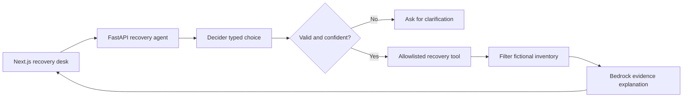

# Trip Rescue

An experimental travel recovery desk: tell it what changed, let a small decision model choose the next tool, and get a recovery explanation grounded in that tool's results.

Built for the AWS Agent Experience Hackathon. Pattern: **tool selection**. Submission tags: `#strands-decider-2b` and `#tool-selection`.

**Current status:** all three scenarios passed with actual local Strands Decider inference and Amazon Bedrock Nova Micro in us-east-1. The UI, live JSON export and 63 backend tests were verified. A temporary EC2 stack was launched, then deleted on 18 October 2026 before the agent or Decider was installed/tested on it. AWS-hosted agent verification, a public repository, published article and recorded video remain. See [live evidence](docs/verification.md) and [cleanup record](docs/aws-cleanup.md).

## Start locally

Node.js 24 and Python 3.12 are recommended. From this folder on Windows:

```powershell
npm ci
python -m venv .venv
.\.venv\Scripts\python.exe -m pip install -r backend/requirements.lock
Copy-Item .env.example .env
npm run dev
```

On macOS/Linux:

```bash
npm ci
python3 -m venv .venv
.venv/bin/python -m pip install -r backend/requirements.lock
cp .env.example .env
npm run dev
```

Open **http://127.0.0.1:3100**. The launcher starts both Next.js (3100) and FastAPI (8100) on loopback. Stop with Ctrl+C. The `.env` file is loaded by the launcher; restart after changing it. `PYTHON_EXECUTABLE` can point to another absolute Python executable path. On this development machine the environment and npm packages have already been installed, so `npm run dev` is enough.

For separate terminals, run `.venv/Scripts/python.exe -m uvicorn backend.app:app --host 127.0.0.1 --port 8100` and `npm run dev:web`. When launching services separately, export backend configuration into the shell environment; Python does not automatically read `.env`.

## Try it

| Scenario | Next tool | Fixture outcome |
| --- | --- | --- |
| Cancelled Varkala–Kochi train | `find_transport` | Coach, alternate train, shared cab within the default constraints |
| Missed Kochi–Bengaluru flight | `find_stay` | Two overnight stays in Kochi; onward travel is separate |
| Monsoon disruption, Munnar–Kochi | `check_disruptions` | Two fictional disruption reports |

Change the train budget to ₹100 to see the no-options state. Clear a location to see clarification. Move the arrival deadline earlier to exclude late options. Select a recovery card to expand its next steps. Export the request, outcome, provenance and trace as JSON.

All inventory is fictional, including prices, times, rooms and reports. Times refer to one fictional day in IST. The map is a schematic illustration, not navigation. No booking, payment or message is sent. Fixture coverage is restricted to the preset routes. Edited free text does not extract or overwrite structured constraints: update the location, budget and time fields too.

## Live mode

The application has two explicit execution modes:

| | Demo | Live models |
| --- | --- | --- |
| Tool decision | Deterministic demo rules | Strands Decider 2B HTTP |
| Explanation | Written template | Amazon Bedrock Converse |
| Travel inventory | Fictional fixtures | Fictional fixtures |
| Confidence / model timing | Absent | Actual provider confidence / measured HTTP round trip |

Run the official Decider server in a **separate Python environment** (its inference dependencies are intentionally excluded from the lightweight backend):

```bash
python3 -m venv .decider-venv
.decider-venv/bin/python -m pip install strands-decider
.decider-venv/bin/strands-decider serve StrandsAgents/strands-decider-2B-qwen3.5-v1-2610 --device cpu --port 8099
```

On Windows, use `.decider-venv\Scripts\python.exe` and `.decider-venv\Scripts\strands-decider.exe`. First use downloads model weights and needs substantial memory/disk; CPU latency is hardware dependent. For CUDA, use the official Linux setup instead of assuming native Windows GPU support. Record the installed Decider package version and model revision when collecting evidence. See [official inference instructions](https://github.com/strands-labs/strands-decider/blob/main/docs/inference.md).

Set these in `.env`:

```dotenv
STRANDS_DECIDER_URL=http://127.0.0.1:8099
STRANDS_DECIDER_MODEL=strands-decider-2B-qwen3.5-v1-2610
BEDROCK_MODEL_ID=your-converse-compatible-model-or-inference-profile-id
AWS_REGION=your-model-region
AWS_PROFILE=your-configured-profile
PROVIDER_TIMEOUT_SECONDS=60
```

Use an actual model/profile available to your AWS account. The verified configuration uses `amazon.nova-micro-v1:0` in `us-east-1`. Bedrock calls incur usage charges. Credentials stay on the backend; use a profile locally or an IAM role on AWS. An approved short-term Bedrock API key can instead be stored as `AWS_BEARER_TOKEN_BEDROCK` in the Git-ignored `.env`; it expires within 12 hours and must be refreshed to continue. Never put it in a browser-exposed variable. For an EC2 role, set `AWS_USE_INSTANCE_ROLE=true` instead of `AWS_PROFILE`. Restart the app. The live button enables when configuration is detected; this does **not** prove endpoint availability or permissions. A successful live run verifies both providers. Errors are shown without falling back to demo.

The initial confidence threshold is `0.8` and can be changed with `DECIDER_CONFIDENCE_THRESHOLD`. Evaluate it on travel examples before drawing accuracy conclusions. Confidence is not presented as a guaranteed probability of correctness. Below the threshold, the workflow asks a clarifying question without running a tool or Bedrock.

## Architecture



The orchestration is deliberately explicit Python, rather than a free-running LLM tool loop. Decider chooses among a fixed tool set before a deterministic dispatcher runs anything. The generative model cannot execute bookings or change tool selection. The [reusable recipe](patterns/README.md) contains the typed question, option set, client, validation, and wiring into the agent path.

## Verify

```powershell
.\.venv\Scripts\python.exe -m pytest backend/tests -q
npm run lint
npm run typecheck
npm run build
```

With the app running, `npm run test:smoke` checks the full same-origin proxy path for all three scenarios and common error states.

The tests cover provider contracts with fake HTTP and Bedrock transports; they do not claim real cloud inference. See [verification record](docs/verification.md) for observed checks and limitations.

## Containers and AWS

```bash
cp .env.example .env
docker compose up --build
```

This serves the demo on `127.0.0.1:3100`. Only the web port is published, and only to loopback. The backend is internal to Compose. Live mode additionally needs a Decider endpoint reachable **from the backend container**, plus a credential source available inside that container. A host's loopback address or local AWS profile is not automatically accessible inside Docker.

For the hackathon, the simplest private AWS deployment is a single EC2 host running the three processes, with an IAM role and Session Manager tunnel. Follow the [AWS deployment guide](docs/aws-deployment.md). This app has no public-user authentication; do not turn the private demo into an unauthenticated paid inference endpoint.

## Project map

- `src/components/`: recovery desk, map, results, and decision log.
- `src/app/api/`: same-origin proxy; model credentials never reach the browser.
- `backend/app.py`: bounded agent workflow.
- `backend/inventory.py`: fictional travel tools and constraints.
- `patterns/tool_selection.py`: reusable Decider recipe.
- `docs/article-draft.md`: draft Builder Center article.
- `docs/demo-script.md`: recording outline under three minutes.
- `docs/submission-checklist.md`: remaining submission work.

This project is original local source. It has not been published or submitted by this build.
